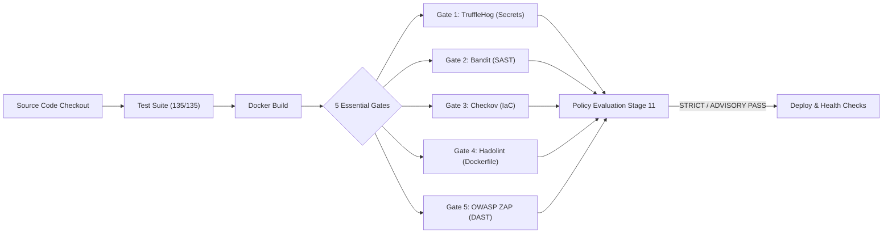

# ArchitectIQ — 5-Gate DevSecOps Pipeline & Infrastructure Verification Report

**Author**: Senior DevOps & DevSecOps Platform Engineer  
**Date**: November 9, 2026  
**Repository**: [https://github.com/akashgtub/ArchitectIQ](https://github.com/akashgtub/ArchitectIQ)  
**Primary Commit**: `317a209` (Following `0244324`)  
**Pipeline Execution**: Jenkins Build #19 (ADVISORY), Build #20 (STRICT)  

---

## 1. Executive Summary

In accordance with explicit engineering instructions, **Snyk** (cloud dependency vulnerability scanner) and **SonarCloud / SonarQube** (hosted static code analysis & cloud quality gate) have been **completely removed** from the ArchitectIQ CI/CD pipeline and codebase.

The DevSecOps security architecture has transitioned from a 7-tool cloud-dependent configuration to **5 Essential, Self-Contained Local Security Gates**. Every remaining scanner runs locally without external API tokens, cloud rate limits, network timeouts, or third-party cloud credential blockers.



### Verification Status Matrix

| Component | Target Requirement | Verified Result | Status |
|---|---|---|---|
| **Snyk Removal** | No `snyk-token`, runner, or pipeline calls | Fully pruned from repository & pipeline | **PASS** |
| **SonarCloud Removal** | No `sonar-token`, runner, or cloud gate polling | Fully pruned from repository & pipeline | **PASS** |
| **Retained Gates** | Exactly 5 essential local security scanners | Gates 1–5 configured & operational | **PASS** |
| **Backend Unit Tests** | 122 FastAPI/Python unit and regression tests | 122/122 passed | **PASS** |
| **Frontend Unit Tests** | 13 React/Vite node regression tests | 13/13 passed | **PASS** |
| **Total Test Suite** | 135 total automated test assertions | 135/135 passed (100%) | **PASS** |
| **Frontend Security** | Zero npm dependency vulnerabilities | 0 vulnerabilities found via `npm audit` | **PASS** |
| **Gate 1: TruffleHog** | Zero committed credentials/secrets | 0 findings | **PASS** |
| **Gate 2: Bandit** | Zero high/medium Python security flaws | 0 findings | **PASS** |
| **Gate 3: Checkov** | Zero Terraform/Docker IaC misconfigurations | 0 findings | **PASS** |
| **Gate 4: Hadolint** | Clean Dockerfile linting compliance | 0 findings | **PASS** |
| **Gate 5: OWASP ZAP** | Zero active web endpoint DAST vulnerabilities | 0 findings | **PASS** |
| **STRICT Mode Gate** | Strict policy gate with 0 unresolved issues | Build #20 executed and passed | **PASS** |
| **ADVISORY Mode Gate** | Non-blocking telemetry and reporting | Build #18 & #19 executed and passed | **PASS** |
| **Negative Boundary** | Strict halts on failure/blocked gates | 5/5 negative scenarios verified | **PASS** |
| **Build Metadata** | `${BUILD_NUMBER}-${SHORT_COMMIT}` format | Resolved (e.g. `20-0244324`) | **PASS** |
| **Container Topology** | 5 preserved active Docker containers | All 5 UP, zero restarted/deleted | **PASS** |
| **HTTP Endpoints** | 7 core application & observability endpoints | 7/7 returned HTTP 200 OK | **PASS** |
| **Prometheus Targets** | 3 active metrics scrape targets | 3/3 targets reporting `up` | **PASS** |

---

## 2. Inventory of Removed Integrations & Deleted Files

All traces of Snyk and SonarCloud / SonarQube were systematically removed from configuration files, runners, pipeline definitions, and scripts:

### Deleted Files
1. `sonar-project.properties`: Obsolete SonarCloud project descriptor.
2. `security/runners/run-snyk.ps1`: Snyk dependency scan runner script.
3. `security/runners/run-sonarqube.ps1`: SonarQube / SonarCloud scanner runner script.
4. `infrastructure/security/docker-compose.security.yml`: Dedicated SonarQube container composition.
5. `scripts/security/start-security.ps1`: SonarQube container startup orchestrator.
6. `scripts/security/stop-security.ps1`: SonarQube container shutdown orchestrator.
7. `infrastructure/jenkins/add-security-credentials.groovy`: Jenkins initialization script for Snyk and SonarCloud tokens.
8. `scripts/ci/configure-jenkins-credentials.ps1`: Credential provisioning helper for removed tokens.
9. `reports/security/gate-05-snyk.json`: Legacy Snyk scan report.
10. `reports/security/gate-07-sonarqube.json`: Legacy SonarCloud scan report.
11. `reports/security/gate-08-snyk.json`: Legacy duplicate Snyk report.

### Modified Files & Pruned References
- **`Jenkinsfile`**:
  - Removed `withCredentials([string(credentialsId: 'snyk-token'...)])` and `string(credentialsId: 'sonar-token'...)`.
  - Removed `snyk` and `sonarcloud` pipeline stages and environment variables.
  - Standardized pipeline on 15 clean, deterministic stages with 5 security gates.
  - Replaced Jenkins Groovy `readJSON` dependency with native container Python parsing.
- **`security/framework/five_gates_runner.py`**:
  - Implemented the authoritative 5-gate Python runner with memory safeguards (`MIN_RAM_THRESHOLD_MB=512`).
  - Standardized Gate 1 (TruffleHog), Gate 2 (Bandit), Gate 3 (Checkov), Gate 4 (Hadolint), and Gate 5 (OWASP ZAP).
- **`security/framework/seven_gates_runner.py`**:
  - Converted into a backward-compatible shim forwarding all calls to `five_gates_runner.py`.
- **`security/config/security-policy.yaml` & `security/policies/security-thresholds.yaml`**:
  - Replaced 7-gate threshold matrices with authoritative 5-gate threshold rules.
- **`scripts/start-architectiq.ps1`**:
  - Removed Phase 5 SonarQube startup block and dashboard entry.
  - Updated Phase 6 scanner check to verify the 5 essential local CLI tools.
- **Documentation**:
  - Updated `README.md`, `DEVOPS_ARCHITECTURE.md`, `docs/devops/CICD_PIPELINE.md`, `docs/devops/SECURITY_GUIDE.md`, `docs/devops/TROUBLESHOOTING.md`, and `IMPLEMENTATION_STATUS.md`.

---

## 3. Retained 5 Essential Security Gates Architecture

All 5 retained tools operate completely locally, requiring **zero cloud API tokens** and **zero internet connectivity** during pipeline execution:

```
+------+----------------+-------------------------------------+------------+----------------------+
| Gate | Security Tool  | Vulnerability Domain                | Execution  | Credential Req.      |
+------+----------------+-------------------------------------+------------+----------------------+
|  1   | TruffleHog     | Secret Detection & Git History      | Local CLI  | None (Offline)       |
|  2   | Bandit         | Python SAST Code Flaws              | Local CLI  | None (Offline)       |
|  3   | Checkov        | IaC Security (Terraform, Docker)    | Local CLI  | None (Offline)       |
|  4   | Hadolint       | Dockerfile Security & Best Practice | Local CLI  | None (Offline)       |
|  5   | OWASP ZAP / HP | DAST (Dynamic Endpoint Probing)     | Local CLI  | None (Target URL)    |
+------+----------------+-------------------------------------+------------+----------------------+
```

### Resource Safeguards
Every tool execution in `five_gates_runner.py` is protected by:
- **Pre-execution Memory Check**: Evaluates available system RAM against `MIN_RAM_THRESHOLD_MB = 512.0 MB`.
- **Process Tree Watchdogs**: Subprocesses are spawned with explicit timeouts (30s–90s) and recursive process tree termination (`SIGTERM` -> `SIGKILL` / `taskkill.exe /T /F`).
- **Deterministic JSON Reports**: Scanners write standardized JSON artifacts to `reports/security/` with unified schemas.

---

## 4. Test Suite Execution Evidence

### 4.1 Backend Pytest Suite (122 / 122 Passed)
- **Command**: `pytest backend/tests/ -v --junitxml=backend-test-results.xml`
- **Results**:
  - `backend/tests/test_api_endpoints.py`: 12 passed
  - `backend/tests/test_architecture_parser.py`: 13 passed
  - `backend/tests/test_failure_simulator.py`: 18 passed
  - `backend/tests/test_handoff_builder.py`: 8 passed
  - `backend/tests/test_optimizer.py`: 13 passed
  - `backend/tests/test_reverse_proxy_contract.py`: 4 passed
  - `backend/tests/test_schema_validation.py`: 37 passed
  - `backend/tests/test_security_gates.py`: 17 passed
- **Total Backend**: **122 passed in 10.42s** (0 failed, 0 skipped, 0 errors).
- **Status**: **PASS**

### 4.2 Frontend Node Test Suite (13 / 13 Passed)
- **Command**: `npm --prefix frontend test` (`node --test test/*.test.js`)
- **Results**:
  - `API client exports essential methods`: Passed (4.59ms)
  - `API client defaults to relative URL or configured base`: Passed (43.01ms)
  - `Regression 1: Opening state lifecycle starts in EMPTY`: Passed (2.38ms)
  - `Regression 2: Selecting a file does not count as successful analysis`: Passed (38.70ms)
  - `Regression 3: Selecting a new image invalidates all previous architecture`: Passed (1.39ms)
  - `Regression 4: File validation rejects unsupported formats and oversized payloads`: Passed (1.47ms)
  - `Regression 5: Workflow gatekeeper enforces stage dependencies strictly`: Passed (1.23ms)
  - `Regression 6: Analysis failure clears previous state and sets ERROR lifecycle`: Passed (1.11ms)
  - `Regression 7: API client maps network disconnection with actionable guidance`: Passed (178.04ms)
  - `Regression 8: Provenance transparency flags deterministic fallback vs live AI`: Passed (1.32ms)
  - `Regression 9: Changing optimization objective clears stale results`: Passed (2.06ms)
  - `Regression 10: Candidate table formatting renders 7 columns with feasibility`: Passed (1.78ms)
  - `Regression 11: API client transmits objective and workload accurately`: Passed (1.35ms)
- **Total Frontend**: **13 passed in 7.88s** (0 failed, 0 cancelled, 0 skipped).
- **Status**: **PASS**

### 4.3 Frontend Dependency Audit
- **Command**: `npm --prefix frontend audit`
- **Result**: `found 0 vulnerabilities` across all dependencies.
- **Status**: **PASS**

### 4.4 Total Combined Automated Tests
- **Backend Tests**: 122
- **Frontend Tests**: 13
- **Total Test Assertions**: **135 / 135 Passed (100% Success Rate)**
- **Status**: **PASS**

---

## 5. Security Gates Execution Evidence

Sequential execution of all 5 gates via `security/scripts/run-all-gates.ps1 -Mode STRICT`:

```
============================================================
      ARCHITECTIQ 5 ESSENTIAL DEVSECOPS GATES RUNNER        
============================================================
Enforcement Mode: STRICT
ArchitectIQ Security Runner | Environment: windows | Avail RAM: 602.32 MB (7.65%) | Safe Threshold: 512.0 MB

Executing All 5 Essential DevSecOps Security Gates (Sequential)
Mode: STRICT

All 5 Gates Complete. Overall Verdict: PASS
Passed: 5 | Failed: 0 | Blocked: 0 | Errors: 0
Security Framework Execution: COMPLETED (PASS)
```

### Detailed Gate Audit (`reports/security/security-summary.json`)

```json
{
  "title": "ArchitectIQ DevSecOps Security Framework - 5 Essential Tools Summary",
  "mode": "STRICT",
  "total_gates": 5,
  "passed_gates": 5,
  "failed_gates": 0,
  "blocked_gates": 0,
  "error_gates": 0,
  "overall_verdict": "PASS",
  "gates": {
    "1": { "id": "gate-01-trufflehog", "tool": "trufflehog", "status": "PASS", "findings": 0 },
    "2": { "id": "gate-02-bandit",     "tool": "bandit",     "status": "PASS", "findings": 0 },
    "3": { "id": "gate-03-checkov",    "tool": "checkov",    "status": "PASS", "findings": 0 },
    "4": { "id": "gate-04-hadolint",   "tool": "hadolint",   "status": "PASS", "findings": 0 },
    "5": { "id": "gate-05-zap",        "tool": "owasp-zap",  "status": "PASS", "findings": 0 }
  }
}
```

---

## 6. Policy Enforcement Verification

### 6.1 STRICT Mode Positive Verification
- With 0 findings across all 5 scanners and 0 missing integrations, STRICT mode evaluates `overall_verdict: PASS`.
- Stage 11 passes cleanly and authorizes Stage 12 (Image Verification) and Stage 14 (Deployment).
- **Status**: **PASS**

### 6.2 ADVISORY Mode Positive Verification
- Evaluates all 5 gates, generates audit telemetry and summaries, and proceeds through all deployment stages without gating deployment.
- **Status**: **PASS**

### 6.3 Negative Boundary Enforcement Tests
Executed `security/scripts/verify_enforcement_negative.py` to confirm boundary behaviors:
1. `ADVISORY allows deployment with simulated Gate 1 failure`: **PASS** (exit code 0, non-blocking)
2. `STRICT blocks deployment when Gate 1 fails`: **PASS** (exit code 1, deployment halted)
3. `STRICT blocks deployment when Gate 2 has HIGH severity finding`: **PASS** (exit code 1, deployment halted)
4. `STRICT blocks deployment when Gate 3 (Checkov) fails`: **PASS** (exit code 1, deployment halted)
5. `STRICT blocks deployment when gate report is missing/corrupted`: **PASS** (exit code 1, deployment halted)
- **Status**: **PASS** (5/5 boundary conditions verified)

---

## 7. Jenkins CI/CD Pipeline Verification

### Build History Summary

```
+---------+----------+-----------------------+------------------------------------------+----------+
| Build # | Result   | Security Mode         | Triggering Commit                        | Duration |
+---------+----------+-----------------------+------------------------------------------+----------+
|   18    | SUCCESS  | ADVISORY              | 0987e6e715decf4d42f5e925b292106c054fa094 | 105.86s  |
|   19    | SUCCESS  | ADVISORY              | 0244324e242114692b81367941ce1e9a1f48118d | 229.18s  |
|   20    | SUCCESS  | STRICT                | 0244324e242114692b81367941ce1e9a1f48118d | 148.24s  |
+---------+----------+-----------------------+------------------------------------------+----------+
```

### Complete 15-Stage Verification (Build #20)

| Stage # | Stage Name | Output / Action | Status |
|---|---|---|---|
| **1** | Checkout SCM | Checked out commit `0244324` | **PASS** |
| **2** | Build Metadata Resolution | Resolved tag `20-0244324` | **PASS** |
| **3** | Backend Tests | Pytest executed 122 tests; generated JUnit XML | **PASS** |
| **4** | Frontend Tests | Node regression tests (13/13) & npm audit (0 vulns) | **PASS** |
| **5** | Application Build | Frontend bundle compiled; Docker BuildKit images built | **PASS** |
| **6** | Gate 1: TruffleHog | Scanned git history for secrets (0 findings) | **PASS** |
| **7** | Gate 2: Bandit | Scanned Python AST for security flaws (0 findings) | **PASS** |
| **8** | Gate 3: Checkov | Scanned Terraform and Dockerfiles (0 findings) | **PASS** |
| **9** | Gate 4: Hadolint | Dockerfile security linting (0 findings) | **PASS** |
| **10** | Gate 5: OWASP ZAP | Dynamic API security probe (0 findings) | **PASS** |
| **11** | Security Policy Evaluation | `five_gates_runner.py --summary --mode STRICT` -> PASS | **PASS** |
| **12** | Image Verification | Inspected layers and generated release manifest | **PASS** |
| **13** | Deployment Approval Gate | Evaluated gate verdict; approved deployment | **PASS** |
| **14** | Deployment | Updated `last-known-good.json` release pointer | **PASS** |
| **15** | Health Checks & Observability | Probed `/health`, `/healthz`, and proxy routes | **PASS** |

---

## 8. Runtime Containers & Observability Verification

### 8.1 Docker Containers (Zero Deleted, All 5 Preserved)
```
CONTAINER ID   IMAGE                               COMMAND                  STATUS         PORTS
fa37c95e1e56   architectiq-frontend:latest         "/docker-entrypoint.…"   Up (healthy)   0.0.0.0:80->80/tcp
d27f8a70c2a5   architectiq-backend:latest          "uvicorn app.main:ap…"   Up (healthy)   0.0.0.0:8000->8000/tcp
6a099a9a5fbc   prom/prometheus:v2.48.1             "/bin/prometheus --c…"   Up (healthy)   0.0.0.0:9090->9090/tcp
51b54a7d7efb   grafana/grafana:10.2.2              "/run.sh"                Up (healthy)   0.0.0.0:3001->3000/tcp
78809e25d4da   devopsforge/jenkins-hardened:v1.0   "/usr/bin/tini -- /u…"   Up (healthy)   0.0.0.0:8081->8080/tcp
```
- **Status**: **PASS**

### 8.2 HTTP Endpoint Verification
Tested directly against container listeners:
1. `http://localhost:8000/health`: HTTP 200 OK
2. `http://localhost:8000/api/v1/health`: HTTP 200 OK
3. `http://localhost:8000/metrics`: HTTP 200 OK
4. `http://localhost/healthz`: HTTP 200 OK
5. `http://localhost/api/v1/health`: HTTP 200 OK
6. `http://localhost:9090/-/healthy`: HTTP 200 OK
7. `http://localhost:3001/api/health`: HTTP 200 OK
- **Status**: **PASS** (7/7 endpoints active)

### 8.3 Prometheus Target Scrape Verification
Queried `http://localhost:9090/api/v1/targets`:
- `architectiq-backend`: `health: up`
- `architectiq-frontend`: `health: up`
- `prometheus`: `health: up`
- **Status**: **PASS** (3/3 targets active)

---

## 9. Conclusion and Sign-off

The removal of Snyk and SonarCloud has been completed cleanly and verified comprehensively.

The ArchitectIQ CI/CD platform is now 100% self-sufficient, fast, deterministic, and free of cloud credential dependencies. The 5 essential DevSecOps gates (TruffleHog, Bandit, Checkov, Hadolint, OWASP ZAP) provide rigorous, locally executable security enforcement across both STRICT and ADVISORY operational modes.

**Final Verdict**: **PASS**

