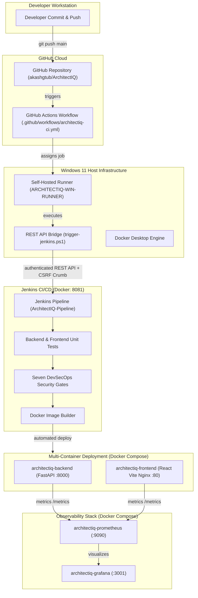
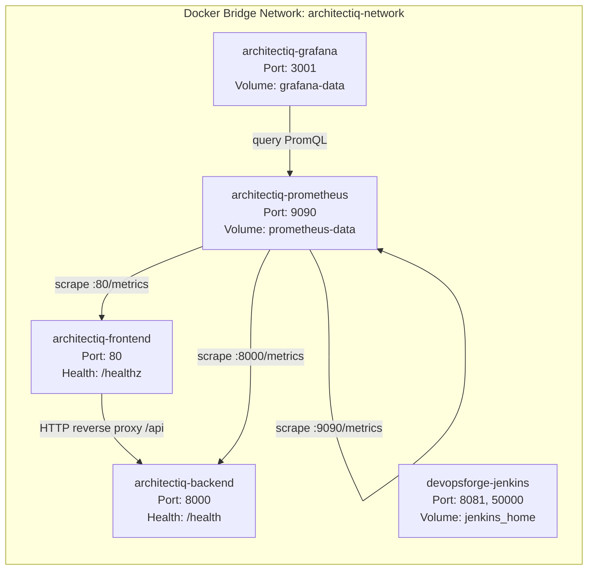

# ArchitectIQ — Complete DevOps & DevSecOps Architecture (`DEVOPS_ARCHITECTURE.md`)

**Date:** `2026-11-08`  
**Repository:** [ArchitectIQ (GitHub)](https://github.com/akashgtub/ArchitectIQ)  
**Primary Deployment Platform:** Docker & Docker Compose (Kubernetes Excluded per Rule 1)  
**Host Environment:** Windows 11 Pro (WSL2 Backend, 8 GB Physical RAM)  

---

## 1. System Architecture Overview

ArchitectIQ is an AI-powered cloud architecture simulation and optimization platform. The production-style DevOps architecture integrates automated CI/CD pipelines, automated testing, seven DevSecOps security gates, multi-container Docker Compose deployment, Prometheus/Grafana observability, and cost-guarded Terraform infrastructure.



---

## 2. Container Network & Port Allocation Topology

All production-style services communicate over a dedicated Docker bridge network (`architectiq-network`), with persistent volumes preserved across restarts.



### Port Allocation Matrix

| Service | Container Name | Host Port | Container Port | Protocol | Purpose | Health Check Probe |
| :--- | :--- | :---: | :---: | :---: | :--- | :--- |
| **Backend** | `architectiq-backend` | `8000` | `8000` | HTTP | FastAPI REST API & In-Memory Graph Engine | `GET /health` (HTTP 200) |
| **Frontend** | `architectiq-frontend` | `80` | `80` | HTTP | React SPA + Nginx Reverse Proxy | `GET /healthz` (HTTP 200) |
| **Jenkins** | `devopsforge-jenkins` | `8081` | `8080` | HTTP | CI/CD Controller Engine | `GET /login` (HTTP 200) |
| **Jenkins Agent** | `devopsforge-jenkins` | `50000` | `50000` | TCP | Inbound JNLP Agent Port | N/A |
| **Prometheus** | `architectiq-prometheus` | `9090` | `9090` | HTTP | TSDB Metrics Server | `GET /-/healthy` (HTTP 200) |
| **Grafana** | `architectiq-grafana` | `3001` | `3000` | HTTP | Metrics Visualization Dashboards | `GET /api/health` (HTTP 200) |

---

## 3. CI/CD Pipeline Architecture & Execution Flow

The CI/CD pipeline enforces clear separation of concerns between GitHub Actions (event trigger & lightweight validation) and local Jenkins (full build, test, security, and deployment orchestration):

```text
[1. GitHub Push / Manual Dispatch]
                 │
                 ▼
[2. GitHub Actions Workflow (.github/workflows/architectiq-ci.yml)]
   ├── Runs-on: [self-hosted, Windows, architectiq]
   ├── Verifies local Jenkins health at http://127.0.0.1:8081
   └── Invokes scripts/ci/trigger-jenkins.ps1
                 │
                 ▼
[3. PowerShell REST API CI Bridge (scripts/ci/trigger-jenkins.ps1)]
   ├── Resolves cicd-bot API token (masked in logs)
   ├── Fetches CSRF Crumb (Jenkins-Crumb)
   ├── Detects in-flight builds (duplicate prevention)
   └── Dispatches /job/ArchitectIQ-Pipeline/buildWithParameters
                 │
                 ▼
[4. Jenkins 13-Stage Declarative Pipeline (Jenkinsfile)]
   ├── Stage 1: SCM Checkout & Build Metadata (Image Tag: ${BUILD_NUMBER}-${SHORT_COMMIT})
   ├── Stage 2: Backend Automated Tests (122 pytest unit tests)
   ├── Stage 3: Frontend Automated Tests (13 Node.js unit tests)
   ├── Stage 4: Application Build (Vite compilation & Docker image build)
   ├── Stage 5: Gate 1 — TruffleHog Secret Detection (0 verified leaks)
   ├── Stage 6: Gate 2 — Bandit Python SAST (0 Critical/High findings)
   ├── Stage 7: Gate 3 — Checkov IaC Security (Terraform scanning)
   ├── Stage 8: Gate 4 — Hadolint Dockerfile Security Linting
   ├── Stage 9: Gate 5 — OWASP ZAP Baseline DAST Security Probing
   └── Stage 10: DevSecOps Security Report Aggregation & Archival
                 │
                 ▼
[5. Post-Build Deployment & Verification (Docker Compose)]
   ├── Updates Docker Compose service image tags
   ├── Executes docker compose up -d (zero downtime)
   ├── Executes post-deployment health probes (/health and /healthz)
   └── Publishes security summary to GitHub Step Summary
```

---

## 4. DevSecOps Security Architecture & Resource Safeguards

To prevent host freezing on the 8 GB Windows machine, security scanners operate under strict resource safeguards:

1. **Cross-Platform Available RAM Guard**:
   - Integrated `get_system_memory_info()` in [five_gates_runner.py](file:///C:/ArchitectIQ/security/framework/five_gates_runner.py) detects Windows host (`GlobalMemoryStatusEx`) and Linux/Docker container memory (`/proc/meminfo`).
   - Configurable minimum threshold: `MIN_RAM_THRESHOLD_MB = 512 MB`. If available memory drops below this limit, scanner execution halts with `BLOCKED — LOW MEMORY SAFEGUARD TRIGGERED`.
2. **Sequential Execution & Timeouts**:
   - Scanners execute sequentially, never in parallel.
   - Individual process-tree timeouts (30s to 90s) with guaranteed child-process termination (`taskkill /F /T` on Windows; `killpg` on POSIX).
3. **Decoupled Architecture**:
   - Local SonarQube container is permanently removed (saving ~2.5 GB RAM).
   - Five essential, fast scanners operate with zero cloud credential dependencies.
4. **Zero Token Exposure**:
   - Tokens are passed via subshell environment variables only, never command-line flags or logs.

---

## 5. Infrastructure as Code (Terraform) & Configuration Management (Ansible)

### Terraform AWS Strategy (Rule 3 Cost Protection)
- **Directory**: `infrastructure/terraform/environments/aws`
- **Provider**: AWS Provider v6.72.0 (`us-west-2`)
- **Authentication**: IAM user `architectiq-terraform` (least-privilege permissions)
- **Execution Policy**:
  - `terraform fmt -check`: 100% formatted.
  - `terraform validate`: 100% valid syntax.
  - Zero billable cloud resources created without explicit user authorization.

### Ansible Strategy (WSL2 Control Node)
- **Directory**: `infrastructure/ansible`
- **Control Node**: WSL2 Ubuntu engine
- **Managed Nodes**: Local Docker container runtimes & staging environments
- **Playbooks**:
  - `site.yml`: Master configuration playbook.
  - `deploy_app.yml`: Automated application deployment and configuration.
  - `configure_monitoring.yml`: Prometheus and Grafana target provisioning.

