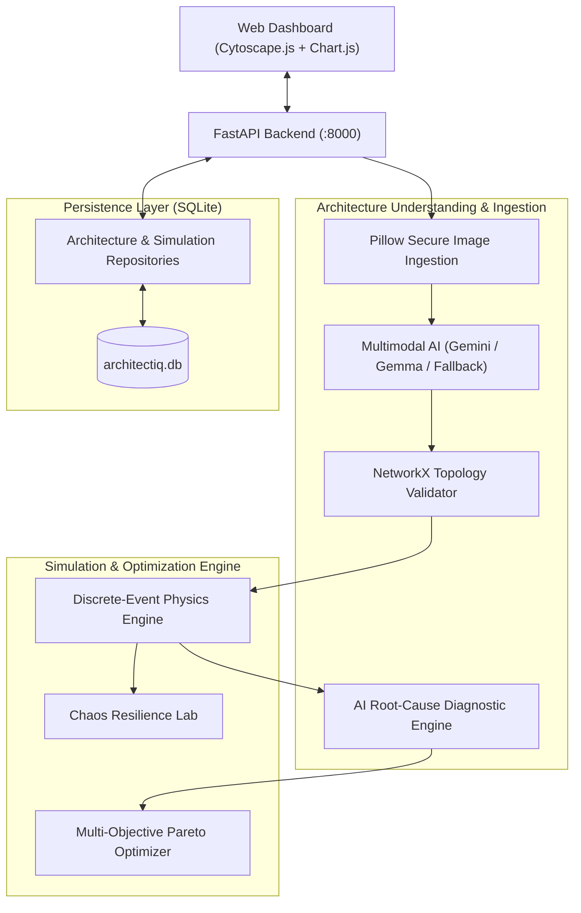

# ArchitectIQ — Autonomous AI Agent for System Architecture Analysis, Optimization, and Resilience Testing

ArchitectIQ is an end-to-end autonomous AI system engineering platform. It ingests system architecture diagrams, validates graph topologies, executes workload-driven discrete-event simulations, discovers performance bottlenecks via AI root-cause analysis, synthesizes alternative candidate architectures through deterministic multi-objective optimization, and stresses systems using chaos engineering resilience experiments.

---

## 🏛️ System Architecture & Integrated Modules



### 1. Ingestion & Graph Validation (Module 2)
* **Secure Image Ingestion**: Pillow-based format verification (`PNG`, `JPEG`, `WEBP`), dimension bounds (10px–4096px), size limit (10MB default), and decompression bomb defense (`Image.MAX_IMAGE_PIXELS`).
* **Multimodal Architecture Extraction**: Google Gemini / Gemma structured extraction distinguishing visual facts, inferred parameters, and unknown variables with graceful deterministic fallback.
* **NetworkX Directed Graph Validation**: Topology verification checking for missing source/targets, duplicate component IDs, self-loops, and valid workload ratios ($Read + Write = 1.0$).

### 2. Discrete-Event Simulation Engine (Module 3)
* **Queue Dynamics & Performance Engine**: Workload-driven discrete simulator modeling request arrival distributions, queue wait times, concurrency limits, component capacities, latency percentiles ($p50$, $p95$, $p99$), throughput RPS, and error rates.
* **Reproducible Execution**: Deterministic random seeds, warm-up intervals, and explicit saturation modeling rather than arbitrary fixed multipliers.

### 3. AI Root-Cause Investigation (Module 4)
* **Hypothesis Testing Engine**: Formulates evidence-backed bottleneck hypotheses with controlled confidence categories (`low`, `medium`, `high`) and executes allowlisted diagnostic experiments.
* **Traceable Optimization Handoff**: Produces canonical `Member1Handoff` payloads conforming to Schema Version `1.0`.

### 4. Deterministic Architecture Optimizer (Module 5)
* **Multi-Objective Candidate Search**: Generates architectural mutations (replica scaling, cache addition, database horizontal scaling, concurrency tuning) targeting user strategies: **Balanced**, **Minimize Latency**, **Minimize Cost**, or **Maximize Throughput**.
* **Pareto Dominance**: Evaluates trade-offs and highlights non-dominated Pareto frontier candidates.

### 5. Chaos Engineering & Resilience Lab (Module 6)
* **Controlled Fault Injection**: Simulates database slowdowns, API replica crashes, cache tier outages, dependency timeouts, and traffic spikes.
* **Degradation Delta & Blast Radius**: Measures latency inflation, throughput drops, and recovery metrics relative to healthy baselines.

### 6. Persistence & Predefined Presets (Modules 1 & 7)
* **SQLite Persistence Layer**: Persists architecture models and simulation histories into `architectiq.db` via thread-safe repositories.
* **Production Presets Catalog**:
  1. *E-Commerce Microservices Platform*
  2. *FinTech High-Assurance Payments Gateway*
  3. *Content Delivery & Video Streaming Platform*
  4. *Basic Three-Tier Enterprise Web Application*

### 7. Modern Engineering Dashboard (Module 7)
* **Interactive Cytoscape.js Graph**: Node-and-edge visual canvas with type-based component color-coding, edge protocol labels, and node inspection.
* **Interactive Chart.js Visualizations**: Latency distribution percentiles, component CPU/queue load bars, Pareto trade-off scatter plots, and resilience delta comparisons.
* **Dark Engineering Theme**: Modern slate/charcoal dashboard with restrained green and red accents, high contrast, and accessible typography.

---

## 📁 Repository Layout

```text
ArchitectIQ/
├── .env.example                     # Environment configuration template
├── .gitignore                       # Git ignore rules for secrets, builds, node_modules
├── pytest.ini                       # Pytest configuration
├── requirements.txt                 # Python dependencies
├── README.md                        # Project documentation
├── backend/
│   ├── config.py                    # Application settings, limits, and env loading
│   ├── main.py                      # FastAPI entrypoint, lifespan init, and static mounting
│   ├── ai_agent/                    # Ingestion, validation, and root-cause modules
│   │   ├── image_validator.py       # Pillow security and decompression bomb defense
│   │   ├── gemma_client.py          # Gemini/Gemma multimodal extraction client
│   │   ├── graph_validator.py       # NetworkX topology and workload validation
│   │   ├── architecture_parser.py   # Diagram extraction orchestration service
│   │   ├── root_cause.py            # Diagnostic experiment and hypothesis ledger
│   │   └── handoff_builder.py       # Versioned optimization handoff assembler
│   ├── api/                         # REST API service and routes
│   │   ├── routes.py                # Unified endpoints (presets, history, simulation, etc.)
│   │   ├── presets.py               # Predefined system architecture catalog
│   │   └── service.py               # Facade for simulation, optimization, and chaos
│   ├── persistence/                 # Persistence layer
│   │   ├── database.py              # SQLite connection and table initialization
│   │   └── repositories.py          # Repositories for architectures and run histories
│   ├── simulator/                   # Discrete simulation engine
│   │   ├── schemas.py               # Simulation Pydantic v2 data models
│   │   ├── workload.py              # Synthetic workload generation profiles
│   │   ├── performance.py           # Latency distribution and metrics calculations
│   │   └── engine.py                # Discrete-event simulation engine
│   ├── optimizer/                   # Architecture optimizer
│   │   └── optimizer.py             # Candidate generation, ranking, and Pareto search
│   ├── chaos_lab/                   # Chaos engineering resilience lab
│   │   └── failure_simulator.py     # Fault injection scenarios and blast-radius analysis
│   ├── shared/                      # Shared canonical contracts and adapters
│   │   ├── schemas.py               # Canonical data contract (Schema v1.0)
│   │   └── adapter.py               # Bidirectional schema and simulator adapter
│   └── tests/                       # Automated test suite (124 passing tests)
│       ├── test_presets_and_persistence.py
│       ├── test_api.py
│       ├── test_optimizer.py
│       ├── test_simulator.py
│       └── ...
└── frontend/                        # Modern responsive web application
    ├── package.json                 # Node dependencies (Chart.js, Cytoscape.js, Vite)
    ├── vite.config.js               # Vite dev server configuration with proxy
    ├── index.html                   # Dark-themed semantic HTML5 layout
    ├── src/
    │   ├── style.css                # Dark engineering console design system
    │   ├── api.js                   # Centralized API client module
    │   └── app.js                   # UI controller, Cytoscape graph & Chart.js rendering
    └── test/
        └── api.test.js              # Frontend client unit tests (13 passing tests)
```

---

## 🚀 Setup & Execution Guide

### Prerequisites
* Python 3.11+
* Node.js v18+ and npm

### 1. Install Backend Dependencies
```bash
pip install -r requirements.txt
```

### 2. Configure Environment Variables
Copy `.env.example` to `.env`:
```bash
cp .env.example .env
```
Key configuration parameters:
* `GOOGLE_API_KEY`: Google GenAI API key for Gemini multimodal diagram parsing.
* `GOOGLE_MODEL`: Gemini model identifier (default: `gemini-2.0-flash`).
* `DATABASE_URL`: SQLite connection URI (default: `sqlite:///./architectiq.db`).
* `FRONTEND_ORIGIN`: Allowed frontend origin for CORS (default: `http://localhost:5173`).
* `MAX_UPLOAD_SIZE_MB`: Max upload file size in megabytes (default: `10`).
* `ALLOW_AI_FALLBACK`: Set to `true` to gracefully use deterministic rule-based analysis when no API key is provided.

### 3. Install Frontend Dependencies & Build Bundle
```bash
cd frontend
npm install
npm run build
cd ..
```

### 4. Start the Application
Start the unified FastAPI server (serves backend REST API and the bundled frontend):
```bash
python -m uvicorn backend.main:app --host 0.0.0.0 --port 8000 --reload
```
* **Web User Interface**: Open [http://localhost:8000/](http://localhost:8000/) in any modern browser.
* **Interactive API Swagger Docs**: Open [http://localhost:8000/docs](http://localhost:8000/docs).
* **System Health Endpoint**: [http://localhost:8000/health](http://localhost:8000/health).

Or run frontend in Vite development mode:
```bash
cd frontend
npm run dev
```
Open [http://localhost:5173/](http://localhost:5173/).

---

## 🧪 Testing and Validation

### Run Backend Test Suite
```bash
python -m pytest backend/tests -v
```
**Results:** **124 passed, 0 failed** across AI provider selection, Gemini integration, real discrete simulator, schema models, optimizer, failure simulator, persistence, and graph validation.

### Run Frontend Test Suite
```bash
cd frontend
npm test
```
**Results:** **13 passed, 0 failed**.

---

## 📡 REST API Reference

| Method | Endpoint | Description |
| :--- | :--- | :--- |
| `GET` | `/health` | System health check and schema version |
| `GET` | `/api/v1/presets` | List predefined production architecture templates |
| `GET` | `/api/v1/presets/{id}` | Retrieve complete architecture specification for a preset |
| `GET` | `/api/v1/history/architectures` | List saved architectures from SQLite storage |
| `POST` | `/api/v1/history/architectures` | Save/update architecture in SQLite storage |
| `GET` | `/api/v1/history/architectures/{id}` | Retrieve saved architecture definition |
| `DELETE`| `/api/v1/history/architectures/{id}` | Delete saved architecture definition |
| `GET` | `/api/v1/history/simulations` | List past simulation, optimization, and chaos runs |
| `GET` | `/api/v1/history/simulations/{id}` | Retrieve details of a specific simulation run |
| `POST` | `/api/simulation/run` | Run baseline discrete-event performance simulation |
| `POST` | `/api/optimization/run` | Run candidate generation and multi-objective optimization |
| `POST` | `/api/chaos/run` | Run fault injection chaos resilience testing |
| `POST` | `/api/v1/architecture/analyze` | Ingest diagram image and extract architecture components |
| `POST` | `/api/v1/investigations` | Run baseline simulation and root-cause analysis |
| `GET` | `/api/v1/investigations/{id}` | Retrieve investigation findings and hypothesis status |
| `GET` | `/api/v1/investigations/{id}/handoff`| Retrieve validated optimization handoff JSON |
| `POST` | `/api/v1/simulate/baseline` | Member 2 discrete engine baseline simulation adapter |
| `POST` | `/api/v1/simulate/diagnostic` | Member 2 discrete engine diagnostic experiment adapter |

---

## 🔒 Security Considerations
1. **Diagram Validation**: Uploaded files are decoded in-memory with Pillow, checked for magic headers, bounded between 10px and 4096px, and limited to 10MB to prevent denial of service and decompression bombs (`Image.MAX_IMAGE_PIXELS`).
2. **Secret Redaction**: API keys and tokens are never passed to the frontend or written to diagnostic logs.
3. **Contained Simulation**: Chaos experiments are strictly executed within the discrete simulation sandbox and do not interact with external infrastructure.
4. **Graceful Fallback**: If external AI inference times out or quotas are exceeded, deterministic analysis ensures continuous operation without crashing.
