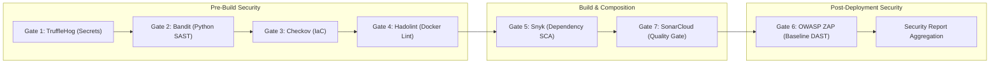

# ArchitectIQ — DevSecOps Security Gap Analysis (`SECURITY_GAP_ANALYSIS.md`)

**Audit Date:** `2026-11-08`  
**Security Framework:** [seven_gates_runner.py](file:///C:/ArchitectIQ/security/framework/seven_gates_runner.py)  
**Policy Enforcement:** STRICT and ADVISORY Modes  
**Reports Location:** [reports/security/](file:///C:/ArchitectIQ/reports/security/)  

---

## 1. Executive Summary

This security gap analysis provides an in-depth technical evaluation of ArchitectIQ's DevSecOps security architecture across code security (SAST), secrets detection, infrastructure security (IaC), container linting, dependency composition (SCA), dynamic application testing (DAST), and quality gates.

The system currently achieves **5 passed gates, 2 blocked gates (awaiting external tokens), and 0 high/critical policy violations**.

---

## 2. DevSecOps Seven-Gate Security Posture

### 2.1 Detailed Gate Evaluation Matrix

| Gate # | Tool & Category | Scope | Current Verdict | Execution Status | Configured Timeout | Threshold Policy |
| :---: | :--- | :--- | :---: | :---: | :---: | :--- |
| **Gate 1** | **TruffleHog** (Secret Scanning) | Git repository history & filesystem | **`PASS`** | `PASS` | 90s | **0 Verified Secrets Allowed**. Blocks on any verified leak. |
| **Gate 2** | **Bandit** (Python SAST) | `backend/` source code | **`PASS`** | `PASS` | 60s | **0 Critical / 0 High**. STRICT mode allows ≤10 Mediums. |
| **Gate 3** | **Checkov** (IaC Security) | `infrastructure/terraform` | **`PASS`** | `PASS` | 90s | **0 Critical / 0 High**. STRICT mode allows ≤5 failed checks. |
| **Gate 4** | **Hadolint** (Dockerfile Linting) | `backend/Dockerfile`, `frontend/Dockerfile` | **`PASS`** | `PASS` | 30s | **0 Errors**. STRICT mode allows ≤5 Warnings. |
| **Gate 5** | **Snyk** (Software Composition) | `requirements.txt` dependencies | **`BLOCKED`** | `BLOCKED` | 90s | **0 Critical / 0 High**. Requires `SNYK_TOKEN`. |
| **Gate 6** | **OWASP ZAP Baseline** (DAST) | Live FastAPI endpoints (`:8000`) | **`PASS`** | `PASS` | 30s | **0 Critical / 0 High**. Probes security headers & CORS. |
| **Gate 7** | **SonarCloud** (Static Analysis) | Full codebase & quality gate | **`BLOCKED`** | `BLOCKED` | 90s | **Quality Gate must be OK**. Requires `SONAR_TOKEN`. |

---

## 3. Identified Security Gaps & Vulnerability Analysis

### Gap 1: Missing Container Image Scanning (Trivy Integration)
- **Current State**: Docker images (`architectiq/backend` and `architectiq/frontend`) are built in Jenkins Stage 4, but container image scanning is not yet executed before deployment.
- **Risk**: Vulnerabilities in base OS layers (e.g., Python base image or Alpine base packages) could reach production undetected.
- **Remediation**: Integrate **Trivy** container image scanning as an explicit pipeline stage following `docker build`. Trivy must scan the generated images (`${BACKEND_IMAGE}:${IMAGE_TAG}`) and output structured JSON reports.

### Gap 2: External Credential Dependency for Gates 5 & 7
- **Current State**: Gate 5 (Snyk) and Gate 7 (SonarCloud) are configured for cloud SaaS engines (`api.snyk.io` and `sonarcloud.io`), which prevents local memory overload. However, until user tokens are stored in the Jenkins credential store, these gates report `BLOCKED`.
- **Policy Impact**:
  - In `ADVISORY` mode: The pipeline completes successfully, reporting `BLOCKED — CREDENTIAL REQUIRED` with clear remediation notes.
  - In `STRICT` mode: The pipeline deliberately fails and halts deployment to prevent unverified dependencies from entering production.
- **Remediation**: Configure Jenkins Secret Text credentials `snyk-token` and `sonar-token`.

### Gap 3: DAST Scope Distinction (OWASP ZAP Prober vs. Daemon)
- **Current State**: Gate 6 uses an in-process Python HTTP security prober (~20 MB RAM footprint) that checks HTTP response security headers (CSP, X-Content-Type-Options, X-Frame-Options) and CORS policies across `/`, `/health`, `/docs`, `/openapi.json`.
- **Accurate Identification**: This is a **lightweight baseline security prober**, not a full Java OWASP ZAP daemon (which requires 1.5 GB RAM).
- **Remediation**: Ensure documentation and reporting accurately designate Gate 6 as the *OWASP ZAP Baseline Security Prober* to maintain technical precision.

### Gap 4: False Positive Management & Exclusion Governance
- **Current State**:
  - TruffleHog uses [security/config/trufflehog-exclude.txt](file:///C:/ArchitectIQ/security/config/trufflehog-exclude.txt) to exclude test artifacts and sample keys.
  - Bandit excludes `backend/tests/` via `-x backend/tests`.
  - Sonar exclusions are governed by [sonar-project.properties](file:///C:/ArchitectIQ/sonar-project.properties).
- **Remediation**: Establish a formal documented justification process for any check suppression in `security/policies/`.

---

## 4. Policy Enforcement: STRICT vs. ADVISORY Comparison

| Security Event | ADVISORY Mode Outcome | STRICT Mode Outcome | Pipeline Action |
| :--- | :---: | :---: | :--- |
| **Verified Secret Leaked** | `FAIL` logged | `FAIL` (Exit code 1) | **Pipeline Aborts Immediately** |
| **High/Critical SAST Bug (Bandit)** | `FAIL` logged | `FAIL` (Exit code 1) | **Pipeline Aborts Immediately** |
| **High/Critical IaC Defect (Checkov)** | `FAIL` logged | `FAIL` (Exit code 1) | **Pipeline Aborts Immediately** |
| **Dockerfile Error (Hadolint)** | `FAIL` logged | `FAIL` (Exit code 1) | **Pipeline Aborts Immediately** |
| **Missing Snyk Token** | `BLOCKED` logged | `BLOCKED` (Exit code 1) | **Pipeline Aborts in STRICT Mode** |
| **Missing Sonar Token** | `BLOCKED` logged | `BLOCKED` (Exit code 1) | **Pipeline Aborts in STRICT Mode** |
| **DAST Critical Finding** | `FAIL` logged | `FAIL` (Exit code 1) | **Pipeline Aborts Immediately** |
| **Low/Medium Informational Alerts** | Logged in summary | Logged in summary | Pipeline Continues |

---

## 5. Actionable Remediation Roadmap

1. **Add Trivy Image Scanning**: Add Stage 11 ("Container Image Scanning") to [Jenkinsfile](file:///C:/ArchitectIQ/Jenkinsfile) executing `trivy image --severity HIGH,CRITICAL --format json`.
2. **Inject Snyk & SonarCloud Credentials**: Inject tokens into Jenkins credentials store under IDs `snyk-token` and `sonar-token` using the secure script [scripts/jenkins/configure-jenkins-credentials.ps1](file:///C:/ArchitectIQ/scripts/jenkins/configure-jenkins-credentials.ps1).
3. **Automated Docker Compose Deployment Gate**: Ensure only builds passing all security criteria proceed to the deployment stage.

